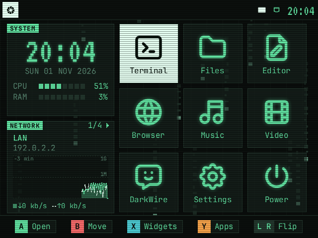
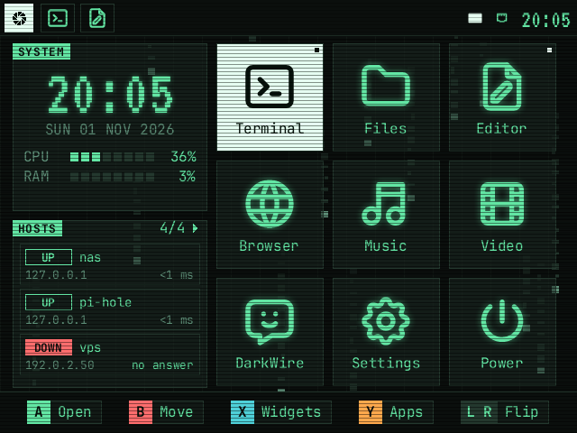
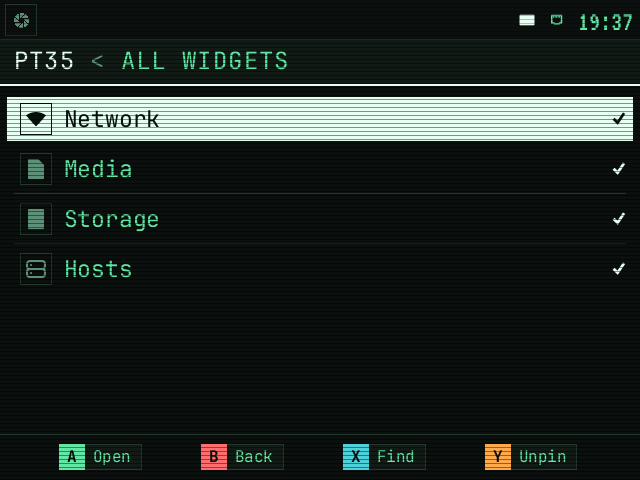
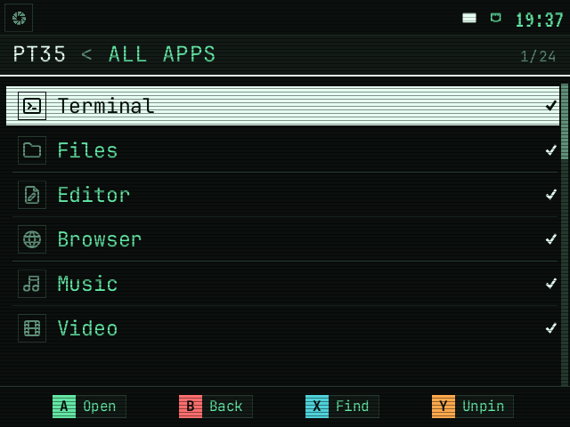
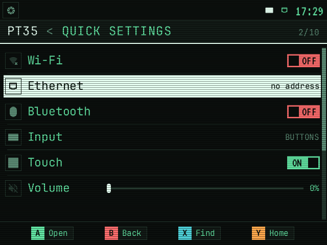
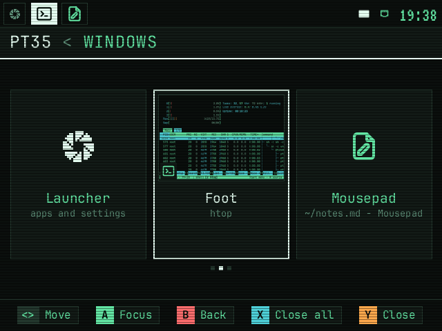
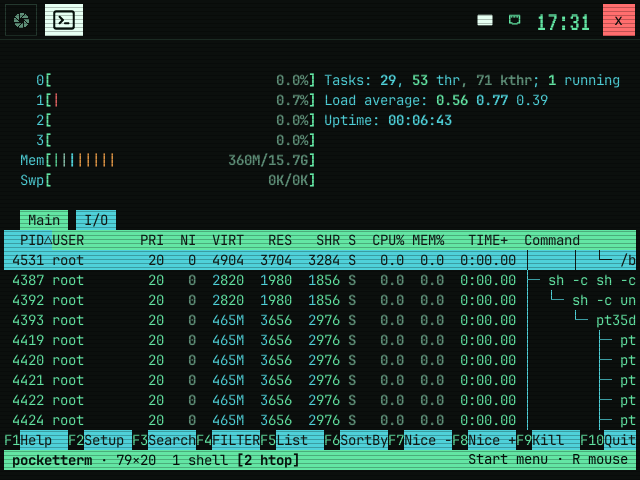
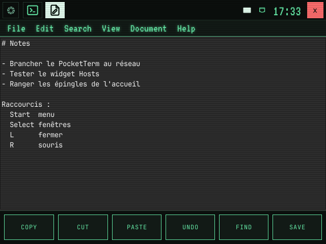
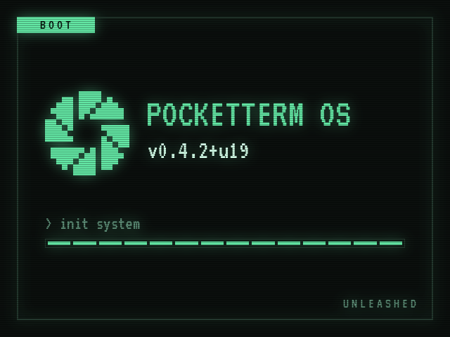

# PocketTerm 3.5 Unleashed

Un thème et quelques réglages pour le
[WaveShare PocketTerm 3.5](https://www.waveshare.com/), au-dessus de
[PocketTerm35-OS](https://github.com/therezor/PocketTerm35-OS).



PocketTerm35-OS fournit le bureau : sway, le lanceur, la barre, la gestion des
boutons. Ce projet s'appuie dessus. Une partie passe par sa configuration
(fichiers dans `~/.config`, fusionnés avec ses défauts), le reste par des
patchs sur [un fork](https://github.com/Kalacione/PocketTerm35-OS), installé à
la place du paquet d'origine. La désinstallation retire nos fichiers.

C'est un projet personnel, testé sur un seul appareil (Raspberry Pi 5, 8 Go).

## Ce que ça ajoute

### Un accueil avec ses apps épinglées

L'accueil n'affiche que les apps épinglées, en grille. Y ouvre Toutes les
apps, où Y épingle ou retire une app (X cherche). Sur l'accueil, B saisit une
tuile, la croix la déplace et A ou B la pose. L'ordre est gardé dans
`~/.local/state/pt35/pinned`. L'installation épingle un premier jeu d'apps.

### Des widgets épinglés

À gauche de l'accueil, un panneau fixe (heure, CPU, RAM) et, dessous, une
pile de widgets épinglés, un visible à la fois. L ou R, ou un toucher sur
l'en-tête, passe au suivant. X ouvre Tous les widgets, où Y épingle.

| | |
|---|---|
|  |  |
| Widget Hosts | Tous les widgets |

- **Network** : la connexion utilisée (LAN, Wi-Fi ou hors ligne), l'adresse IP
  et le débit des trois dernières minutes.
- **Media** : le lecteur en cours (MPRIS), avec précédent, lecture / pause,
  suivant. Il passe devant quand un lecteur démarre.
- **Storage** : le disque système et les clés USB, avec une alerte au-delà de
  75 % puis 90 %.
- **Hosts** : jusqu'à trois hôtes de `~/.ssh/config`, choisis sur l'écran SSH
  (Toutes les apps). Chacun est UP, SLOW ou DOWN ; un toucher ouvre la
  connexion. La liste reste sur l'appareil.

### Le défilement au doigt

Dans PocketTerm35-OS 0.4.2, un toucher est un clic à l'endroit du contact :
une liste ne défile pas au doigt. Ici, le doigt agit quand il se lève. Un
glisser fait défiler la liste sans ouvrir ce qu'il touchait, un balayage
change de carte dans la bascule entre fenêtres, et un appui d'une demi-seconde
ouvre le menu de la ligne (Ouvrir et Épingler sur une app, Fermer sur une
fenêtre).

### Un thème : Phosphore

Vert doux sur fond sombre, police pixel VT323 pour les horloges, JetBrains
Mono pour le texte, lignes de balayage façon écran cathodique. Les états
(ON, OFF, UP, DOWN, FULL) sont écrits en toutes lettres sur fond plein : on
les lit sans distinguer les couleurs. Les icônes des apps viennent de
[Tabler Icons](https://tabler.io/icons). La charte est dans
[`DESIGN.md`](DESIGN.md).

### Des apps réglées pour l'écran

- **Terminal** dans tmux, avec une barre du bas aux couleurs du thème.
- **Fichiers** (yazi) avec des onglets et les hôtes de `~/.ssh/config` :
  copier et coller entre l'appareil et un serveur, ou entre deux serveurs.
- **Musique et Vidéo** sur mpv avec l'interface tactile
  [uosc](https://github.com/tomasklaen/uosc).
- **Éditeur** avec un bandeau de gros boutons (Copy, Paste, Save...) en bas
  de l'écran, une barre de menus aux couleurs du thème et le texte à la taille
  du terminal.
- Un **écran de démarrage** assorti.

## Captures

Rendues à 640x480 depuis le code de la version testée, hors appareil. Les
icônes système et les valeurs affichées diffèrent un peu sur le PocketTerm.

| | |
|---|---|
|  |  |
| Toutes les apps | Réglages rapides |
|  |  |
| Bascule entre fenêtres (Select) | Terminal dans tmux |
|  |  |
| Éditeur et son bandeau | Écran de démarrage |

## Prérequis

| quoi | détail |
|---|---|
| matériel | WaveShare PocketTerm 3.5 avec Raspberry Pi 5 (testé, 8 Go) ou Pi 4B |
| système | Raspberry Pi OS **Trixie 64 bits**, Lite conseillé (Bookworm n'est pas supporté par PocketTerm35-OS) |
| réseau | Wi-Fi ou Ethernet |

## Installation

Tout se fait sur le PocketTerm, dans un terminal ou en SSH.

### A. Socle : PocketTerm35-OS

**1. Vérifier le système**

```sh
grep VERSION_CODENAME /etc/os-release   # trixie
getconf LONG_BIT                        # 64
```

Si ce n'est pas Trixie 64 bits, flasher Raspberry Pi OS Lite (Trixie, 64 bits)
avec Raspberry Pi Imager, puis recommencer.

**2. Neutraliser les anciens pilotes d'écran Waveshare** (si présents)

PocketTerm35-OS configure lui-même l'écran et le tactile. Une ancienne
installation Waveshare laisse ses propres overlays dans `config.txt`, qui
feraient doublon. Les commenter **avant** l'étape 3, sans redémarrer entre les
deux :

```sh
grep -n 'waveshare' /boot/firmware/config.txt          # rien : passer à l'étape 3
sudo sed -i.waveshare.bak 's/^dtoverlay=waveshare/#&/' /boot/firmware/config.txt
grep -n 'waveshare' /boot/firmware/config.txt          # chaque ligne commence par #
```

**3. Installer PocketTerm35-OS et flasher le clavier**

L'installeur de PocketTerm35-OS prépare le système (session, écran, tactile,
firmware du clavier). L'étape 6 remplace ensuite son paquet par la version
testée avec ce projet.

```sh
curl -fsSL https://raw.githubusercontent.com/therezor/PocketTerm35-OS/main/install.sh | sudo bash
sudo pt35-kbd flash
```

- Sur Raspberry Pi OS Desktop, l'installeur prévient qu'il remplace la session.
  C'est réversible (`--uninstall`).
- Il propose un agent IA local (darkwire). Optionnel : `n` pour s'en passer.
- Il ajoute son bloc à `config.txt` et en garde une copie dans
  `config.txt.pt35.bak`.
- Sans le firmware flashé, les boutons A B X Y L R envoient des lettres.

**4. Redémarrer**

```sh
sudo reboot
```

Le PocketTerm démarre sur le bureau PocketTerm35-OS. Si l'écran ou le tactile
ne répond plus, restaurer l'ancienne config en SSH :

```sh
sudo cp /boot/firmware/config.txt.waveshare.bak /boot/firmware/config.txt && sudo reboot
```

### B. Ce projet

**5. Récupérer le dépôt**

```sh
sudo apt update && sudo apt install -y git stow
git clone https://github.com/Kalacione/pocketterm35-unleashed.git ~/pocketterm35-unleashed
cd ~/pocketterm35-unleashed
```

**6. Installer la version testée de PocketTerm35-OS, puis nos réglages**

```sh
./install.sh --pt35   # le paquet de la version écrite dans PT35_VERSION
./install.sh          # nos réglages
sudo reboot
```

`./install.sh` relie les fichiers de `home/` dans `~` avec GNU stow. Un
fichier existant au même endroit est renommé en `.bak` et restauré à la
désinstallation. Il installe aussi les paquets Debian nécessaires (mpv, tmux,
playerctl...), uosc (version et empreinte vérifiées), la police JetBrains Mono
et les icônes dans `/usr/share` où PocketTerm35-OS les cherche, et l'écran de
démarrage si Plymouth est présent (une minute pour reconstruire l'initramfs).

**7. Vérifier**

```sh
ls -l ~/.config/sway/config   # lien vers ~/pocketterm35-unleashed/home/...
```

Logs : `/run/user/1000/pt35/sway.log`. `pt35ctl reload` recharge thème, menu
et apps, `Super`+`Shift`+`c` recharge sway.

## Mise à jour

```sh
cd ~/pocketterm35-unleashed && git pull && ./install.sh --pt35 && ./install.sh
```

Puis redémarrer si `PT35_VERSION` a changé.

## Versions

Le projet est testé avec une seule version de PocketTerm35-OS, écrite dans
[`PT35_VERSION`](PT35_VERSION). L'installeur de PocketTerm35-OS prend toujours
la dernière version : `./install.sh` s'arrête alors et propose
`./install.sh --pt35`. `./install.sh --force` passe outre.

Une version en `+u<n>` (par exemple `0.4.2+u1`) est PocketTerm35-OS avec nos
patchs. Le [CHANGELOG du fork](https://github.com/Kalacione/PocketTerm35-OS/blob/main/CHANGELOG.md)
les décrit un par un. Pour revenir à la version d'avant : `git revert` du
dernier commit de `PT35_VERSION`, puis la mise à jour ci-dessus.

## Désinstallation

```sh
cd ~/pocketterm35-unleashed && ./install.sh --uninstall
```

Les liens sont retirés, les `.bak` restaurés et l'écran de démarrage de
Raspberry Pi OS remis. Puis `pt35ctl reload`. Le paquet de PocketTerm35-OS
installé reste celui de `PT35_VERSION`.

## Contenu

| chemin | rôle |
|---|---|
| `home/` | fichiers reliés dans `~` par `install.sh` |
| `home/.config/sway/config` | inclut la config sway de PocketTerm35-OS, ajoute les scanlines sur les apps, Super+Entrée ouvre le Terminal avec tmux |
| `home/.config/pt35/theme.toml` | thème Phosphore : couleurs et polices du menu et de la barre |
| `home/.config/pt35/apps.toml` | Musique passe de VLC à mpv, Terminal dans tmux, Fichiers charge les hôtes SSH |
| `home/.config/pt35/wallpaper.svg` | fond d'écran du lanceur |
| `home/.config/foot/foot.ini` | couleurs et police du terminal |
| `home/.config/tmux/tmux.conf` | barre du bas du Terminal, souris et copie |
| `home/.config/gtk-3.0/gtk.css` | barre de menus de l'éditeur (Mousepad) |
| `home/.config/gtk-4.0/gtk.css` | couleurs des apps GTK4 |
| `home/.config/mpv/` | mpv et uosc aux couleurs du thème, boutons A, X, Y ; sans fichier, un accueil pour parcourir sa médiathèque ou ouvrir une URL (`scripts/pt35-home.lua`) |
| `home/.config/yazi/` | yazi (Fichiers) aux couleurs du thème ; A ouvre, B revient, X ouvre Lieux (dossier perso, ou un hôte SSH dans un nouvel onglet), Y liste les onglets (Y encore = nouvel onglet), Ctrl+C / X / V, onglets Ctrl+T / W |
| `home/.local/bin/pt35-yazi-vfs` | traduit `~/.ssh/config` pour le SFTP de yazi, à chaque ouverture de Fichiers |
| `home/.local/bin/pt35-actions` | bandeau d'actions sous l'éditeur |
| `home/.local/share/fonts/` | police pixel VT323 des horloges |
| `home/.local/share/icons/Phosphore/` | icônes des apps, tirées de Tabler Icons, Papirus pour le reste |
| `plymouth/pocketterm/` | thème Plymouth de l'écran de démarrage |
| `tools/splash.py` | dessine les images de démarrage depuis `DESIGN.md` ; lancé par `install.sh` |
| `tools/icons.sh` | regénère les icônes depuis Tabler, couleur en option |
| `tools/ship.sh` | publie une version du fork et l'épingle dans `PT35_VERSION` |
| `install.sh` | installation, désinstallation, retour à la version testée |
| `PT35_VERSION` | version de PocketTerm35-OS testée |
| `DESIGN.md` | charte graphique au format [DESIGN.md](https://github.com/google-labs-code/design.md) |
| `docs/captures/` | captures de ce README |
| `docs/design/` | aperçu de la charte (`charte.html`), maquettes et rendus de travail |
| `docs/specs.md` | specs, priorités et TODO |
| `docs/briques.md` | logiciels retenus ou écartés, et pourquoi |
| `CLAUDE.md` | règles du projet, pour les contributeurs humains et IA |

## Contribuer

Les issues sont bienvenues : un bug, une question, une idée. Les pull requests
ne sont pas acceptées pour l'instant, faute de temps pour les suivre. Ce qui
servirait à tous les PocketTerm a plutôt sa place chez
[PocketTerm35-OS](https://github.com/therezor/PocketTerm35-OS).

## Remerciements

- [PocketTerm35-OS](https://github.com/therezor/PocketTerm35-OS) de
  [therezor](https://github.com/therezor) : bureau, lanceur, configuration
  fusionnée, hooks et firmware du clavier. Tout ce projet repose dessus.
- [WaveShare](https://www.waveshare.com/) pour le PocketTerm 3.5.
- [Tabler Icons](https://tabler.io/icons), [VT323](https://fonts.google.com/specimen/VT323),
  [JetBrains Mono](https://www.jetbrains.com/lp/mono/),
  [uosc](https://github.com/tomasklaen/uosc),
  [Papirus](https://github.com/PapirusDevelopmentTeam/papirus-icon-theme).

## Licence

MIT ([LICENSE](LICENSE)).

Composants tiers :

| composant | licence | dans ce dépôt |
|---|---|---|
| PocketTerm35-OS, Copyright (c) 2026 REZOR | MIT ([licence](https://github.com/therezor/PocketTerm35-OS/blob/main/LICENSE)) | non ; les `.deb` des releases de ce dépôt sont ses binaires non modifiés, avec sa licence |
| Tabler Icons, Copyright (c) 2020-2024 Paweł Kuna | MIT ([licence](home/.local/share/icons/Phosphore/LICENSE)) | oui, recolorées |
| VT323, Copyright 2011 The VT323 Project Authors | SIL OFL 1.1 ([licence](home/.local/share/fonts/VT323-OFL.txt)) | oui |
| JetBrains Mono | SIL OFL 1.1 | non, paquet Debian |
| uosc | LGPL-2.1 | non, téléchargé par `install.sh` |
| Papirus | GPL-3.0 | non, installé par PocketTerm35-OS |
